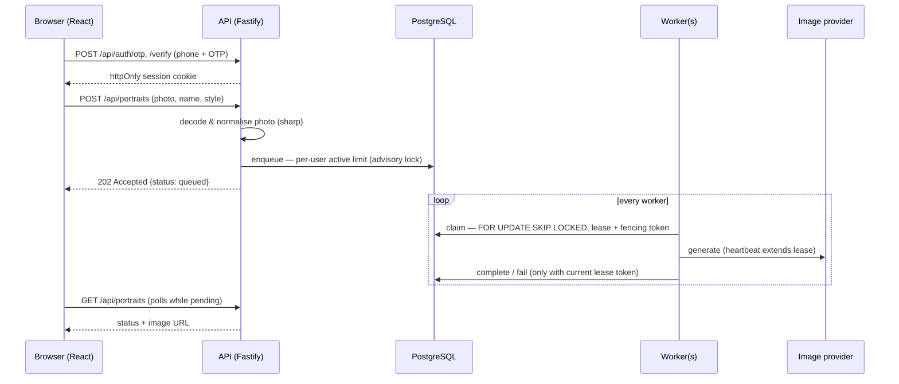

# AI Portrait Generator

[](https://github.com/tnKiness/ai-portrait-generator/actions/workflows/ci.yml)


Upload a photo, pick a style, get back an AI-painted portrait with your name on it.

Behind that simple flow is the part that matters in production: **a durable job queue on PostgreSQL** that survives crashed workers, retries flaky AI calls with backoff, stops one user from flooding the system, and never lets a slow worker overwrite a newer result.


<sub>Input photo → Watercolor · Pop art · Pencil sketch (rendered by the offline `mock` provider).</sub>

> I built a portrait-generation campaign app with this shape for a national fashion brand. This repository is an independent, from-scratch reimplementation of the core ideas — no client code or assets.

---

## How it works



## Engineering highlights

| Problem | Solution | Code |
|---|---|---|
| Many workers polling one table | `UPDATE … WHERE id = (SELECT … FOR UPDATE SKIP LOCKED LIMIT 1)` — no double claims, no blocking | [queue.ts](server/src/queue.ts) |
| Worker crashes mid-job | Every claim gets a lease; a reaper re-queues expired leases | `reclaimExpired` |
| Slow worker finishes after its job was re-assigned | Lease token doubles as a **fencing token** — stale `complete()` is rejected | `complete`, test *fencing* |
| Flaky AI API | Exponential backoff (5s → 5min cap), max attempts, 4xx treated as permanent | `fail`, [openai.ts](server/src/providers/openai.ts) |
| One user spamming "generate" | Per-user active-job limit, made race-free with `pg_advisory_xact_lock` | `enqueue`, test *concurrent requests* |
| Untrusted uploads | Decode with sharp (ignore MIME/filename), size & dimension limits, EXIF rotate, strip metadata | [photo.ts](server/src/photo.ts) |
| OTP abuse | Hashed codes, 60s resend cooldown, 5-attempt lockout, constant-time compare | [auth.ts](server/src/auth.ts) |
| Session theft | Random 256-bit token, only its SHA-256 stored, `httpOnly` + `SameSite=Lax` cookie | [auth.ts](server/src/auth.ts) |
| Probing other users' data | Ownership checked in SQL; missing and foreign ids both return 404 | [app.ts](server/src/app.ts) |
| Swapping AI vendors | `PortraitProvider` interface; `mock` (offline) and `openai` implementations | [providers/](server/src/providers) |
| Graceful deploys | On `SIGTERM` the worker stops claiming, cancels in-flight generations via `AbortSignal` and re-queues them | [worker-core.ts](server/src/worker-core.ts) |

**31 tests** run against a real PostgreSQL — each test file gets its own throwaway database, so they run in parallel ([test/](server/test)).

## Tech stack

**Backend:** Node.js 22 · TypeScript · Fastify 5 · PostgreSQL 17 (`pg`) · sharp · Zod
**Frontend:** React 19 · Vite
**Tooling:** Vitest · ESLint · Docker / Compose · GitHub Actions

## Run it locally

Requires Node.js 22 and Docker.

```bash
cp .env.example .env
npm install
npm run db:up        # PostgreSQL in Docker
npm run dev:api      # API on :3000 (runs migrations on start)
npm run dev:worker   # worker
npm run dev:web      # UI on http://localhost:5173
```

Sign in with any Vietnamese mobile number — in development the OTP is printed in the API console. No AI key is needed: the default `mock` provider applies a local filter. To use a real model, set `IMAGE_PROVIDER=openai` and `OPENAI_API_KEY` in `.env`.

Or run the whole stack in containers:

```bash
docker compose --profile app up --build   # http://localhost:3000
```

### Checks

```bash
npm run check   # lint → typecheck → tests → build (same as CI)
```

## Project layout

```text
server/
  migrations/        SQL migrations, applied automatically on start
  src/
    app.ts           HTTP routes, validation, error mapping
    auth.ts          OTP + sessions
    queue.ts         PostgreSQL job queue (claim / heartbeat / complete / fail / reclaim)
    worker-core.ts   worker loop, leases, graceful shutdown
    photo.ts         upload validation & normalisation
    providers/       mock + OpenAI image providers, caption rendering
    web.ts, worker.ts  entrypoints
  test/              integration tests on real PostgreSQL
web/                 React UI (sign in → create → gallery with live status)
```

## What I'd add next

- Object storage (S3/R2) behind the existing `Storage` interface, with signed URLs
- `LISTEN/NOTIFY` or SSE instead of polling for status updates
- Real SMS/Zalo OTP sender and per-IP rate limiting
- Metrics (queue depth, job latency, failure rate) and an admin view to retry failed jobs

## License

[MIT](LICENSE) © tnKiness
